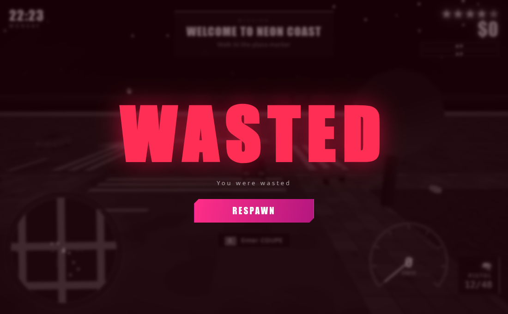

# VICE CITY 6 — Neon Coast

A neon-noir, open-world action sandbox that runs in a browser. Steal a car,
take the money, outrun the lights.

Built with **Three.js + TypeScript + Vite**. Every texture, mesh and sound is
generated procedurally at runtime — the game ships with **zero binary assets**,
makes **no network calls at runtime**, and works completely offline.


---

## Quick start

```bash
npm install
npm run dev        # http://127.0.0.1:5173
```

```bash
npm run build      # type-check + production bundle into dist/
npm run preview    # serve the production build on :4173
npm test           # build + headless smoke suite + behaviour suite
```

Click the canvas to capture the mouse, then walk.

## Controls

| Key | Action |
| --- | --- |
| `W` `A` `S` `D` | Move on foot / drive |
| `Shift` | Sprint |
| `Space` | Jump (on foot) / handbrake (in a car) |
| `E` | Enter or exit a vehicle |
| Mouse | Look around |
| Right mouse | Aim weapon |
| Left mouse | Fire |
| `R` / `Q` / `H` | Reload / switch weapon / horn |
| `M` | World map |
| `Esc` | Pause (releases the mouse) |

Touch controls (virtual stick plus buttons) appear automatically on touch
devices.

## What is in the game

**The city** — a 6×6 block grid split into five districts: downtown towers,
uptown mid-rise, an industrial yard with shipping containers, suburban
houses and a beachfront. Roads, pavements, zebra crossings, working traffic
lights, street lamps, palms, billboards, benches and hydrants are all
generated from a fixed seed, so the city is identical every run.

**Driving** — six vehicle archetypes with arcade physics: an engine torque
curve, speed-dependent steering, lateral grip, handbrake drifts, body roll and
pitch, damage and smoke. Collisions are resolved against the buildings with
an impulse response.

**Life** — pedestrians walk the pavement loops of their blocks, scatter from
gunfire, from your car and from the horn, and can be run over. Traffic AI
follows the road graph in the correct lane, stops at red lights, queues behind
other cars and brakes for you.

**Heat** — a five-star wanted system. Crimes add heat (gunfire, murder,
hit-and-run, car theft in front of a cruiser); police dispatch more units as
the stars climb; they chase and ram you; the heat cools when you break line
of sight. From two stars, officers also come **on foot**: they hunt you down,
take aim, open fire and will bust you if they get close.

**Missions** — a six-mission chain: *Welcome to Neon Coast*, *Grand Theft
Auto*, *Special Delivery*, *Heat*, *Clean Sweep* and the repeatable *Courier
Run*, with multi-step objectives, time limits and cash rewards.

**Presentation** — a full day/night cycle (sun, moon, stars, sunset
gradients), emissive shop windows after dark, headlights, pools of light under
the street lamps, a heading-up radar with live blips, a full-screen city map,
a needle speedometer, damage flashes, a WASTED screen and a pause menu with
persistent settings.

**Audio** — everything is synthesised with the Web Audio API: an engine tone
that tracks the revs, two-tone sirens, gunshots, crashes, explosions, UI blips
and a procedural synthwave loop.

## Screenshots

| | |
| --- | --- |
|  |  |
|  |  |
|  |  |

## Project layout

```
src/
  main.ts           bootstrap
  Game.ts           orchestration: state machine, loop, rules
  core/             input, maths, procedural textures
  world/            city grid, city geometry, props, sky
  entities/         cars, physics, player, pedestrians, officers, traffic AI
  systems/          collision, camera, weapons, missions, wanted, effects, audio
  ui/               HUD, radar, map, menus
docs/               implementation documentation
scripts/            headless test suites and the screenshot tour
```

## Documentation

| Document | Contents |
| --- | --- |
| [docs/README.md](docs/README.md) | Index and conventions |
| [docs/architecture.md](docs/architecture.md) | Module map, game loop, ownership rules, extension points |
| [docs/world.md](docs/world.md) | City generation, districts, facades, props, road network |
| [docs/gameplay.md](docs/gameplay.md) | Vehicles, traffic, pedestrians, police, combat, missions |
| [docs/algorithms.md](docs/algorithms.md) | Arcade physics, lane following, collisions, hitscan, day/night |
| [docs/interface.md](docs/interface.md) | HUD, radar, world map, menus, audio, settings |
| [docs/testing.md](docs/testing.md) | The headless suites and what they assert |
| [docs/development.md](docs/development.md) | Toolchain, conventions, debugging techniques |
| [AGENTS.md](AGENTS.md) | Rules for working in this repository |

## Performance

The static world is merged into a handful of buffers per material and repeated
props use instanced meshes. A populated city — around 40 vehicles, 26
pedestrians, officers and all the street furniture — renders in roughly
**250 draw calls and 65 k triangles**.

## Testing

`npm test` boots the production build in headless Chrome and asserts on real
gameplay: the player walks, drives, enters a car, completes a mission step,
shoots a pedestrian and raises a star, and the police respond. It also
compares the number of rendered objects against the number of simulated ones,
so an entity that simulates but never appears on screen fails the build.

The second suite (`scripts/behaviour.mjs`) guards the systems that are easy to
break: road discipline, car following, pedestrian paths, the stability of the
wanted level and the police response.

## Notes

An original homage to the open-world crime-sandbox genre. All art, geometry,
audio and code in this repository are generated from scratch and are not
affiliated with, or derived from, any commercial game.
