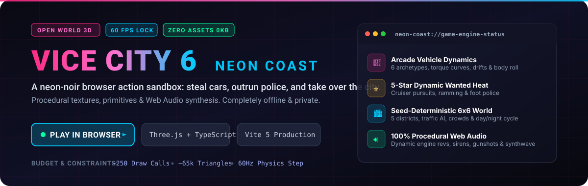
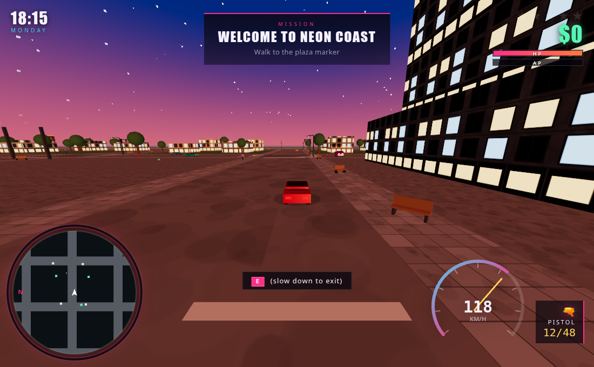
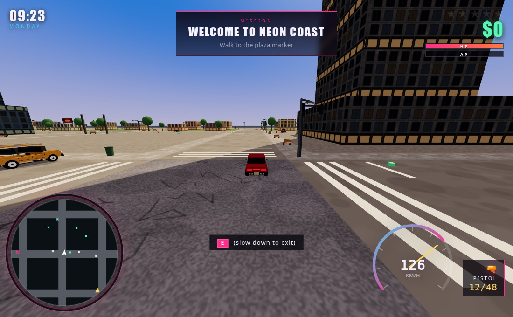
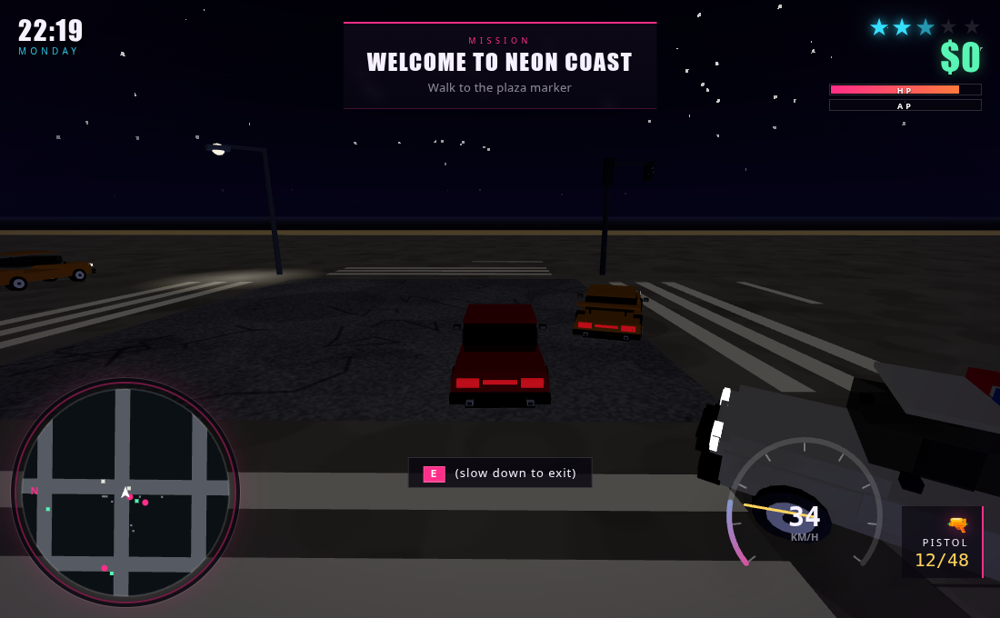
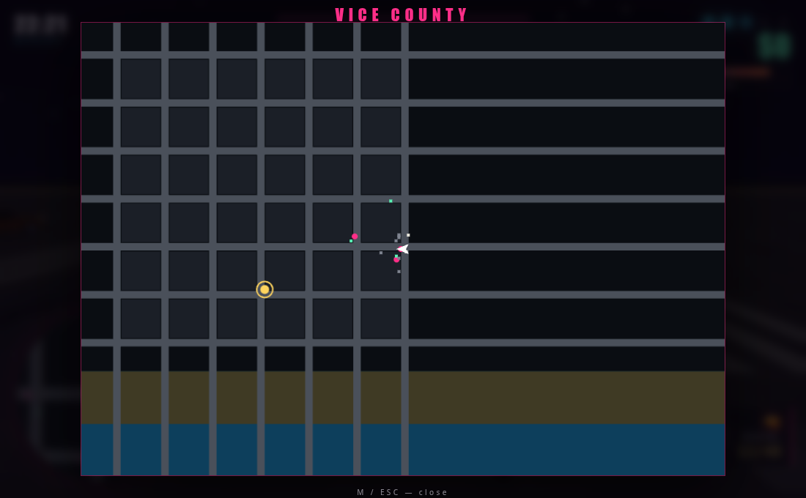
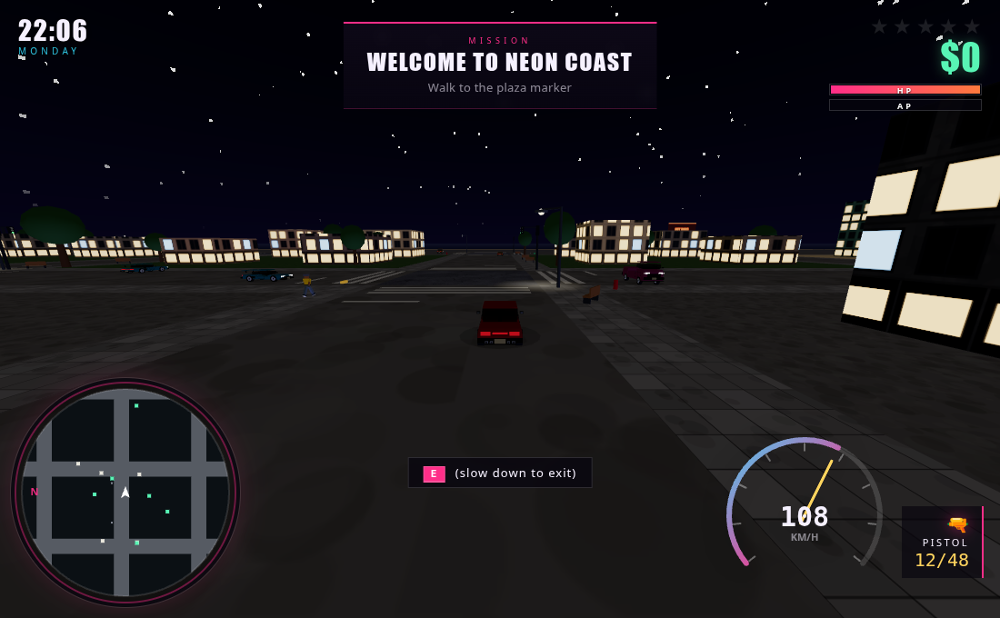
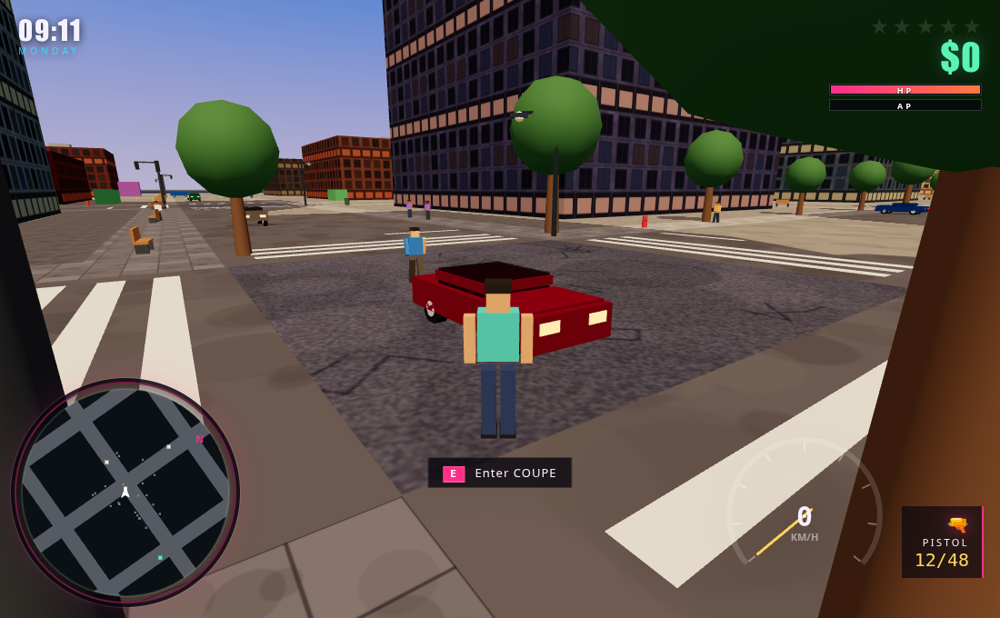
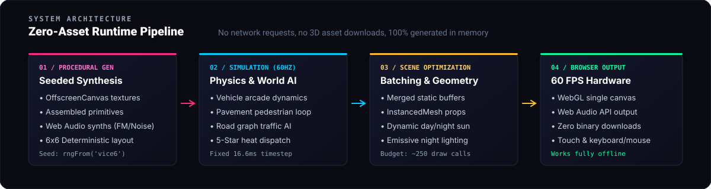

<div align="center">

<a href="https://youxufkhan.github.io/vicecity6/">
  
</a>

<br/><br/>

[](https://youxufkhan.github.io/vicecity6/)
[](https://threejs.org/)
[](https://www.typescriptlang.org/)
[](https://vitejs.dev/)
[](https://youxufkhan.github.io/vicecity6/)
[-ff2a85?style=for-the-badge)](#zero-asset-engine-architecture)

<br/>

### 🌴 [▶ PLAY IN YOUR BROWSER NOW (GitHub Pages)](https://youxufkhan.github.io/vicecity6/) 🌴
**Zero external assets • Zero downloads • Pure WebGL & Web Audio • Fully offline**

</div>

---

## Overview

**VICE CITY 6 — Neon Coast** is a neon-noir, open-world 3D action sandbox running entirely in modern web browsers at a locked 60 FPS. 

Steal vehicles, complete multi-stage criminal missions, drift down palm-lined avenues, and outrun an escalating five-star police response through dynamic day-and-night cycles.

- ⚡ **Zero Binary Assets**: Every texture is procedurally painted on an `OffscreenCanvas`, every vehicle and building is built from mathematical primitives, and every gunshot, tire screech, and synthwave tune is synthesised via the Web Audio API.
- 🌐 **Completely Offline**: Makes zero runtime network requests and caches cleanly.
- 🎯 **Fixed 60Hz Physics & AI**: Deterministic arcade car handling, road-graph traffic AI, pedestrian navigation, and tactical police AI.

---

## Gameplay Showcase

| Day & Night Cycle | High-Speed Driving |
|:---:|:---:|
|  |  |
| *Procedural sun, moon, and emissive building lights* | *Arcade physics, torque curves, and handbrake drifts* |

| Tactical Combat & Wanted Heat | Full City Map & Navigation |
|:---:|:---:|
|  |  |
| *5-star wanted dispatch with cruisers & foot officers* | *6×6 block seeded procedural district layout* |

| Night Neon Atmosphere | On-Foot Free Roam |
|:---:|:---:|
|  |  |
| *Headlights, neon signs, and street lamp lighting* | *Pavement navigation, crowd reactions, and weapons* |

---

## Quick Start

### 1. Run Locally

```bash
# Clone the repository
git clone https://github.com/youxufkhan/vicecity6.git
cd vicecity6

# Install dependencies (supports pnpm and npm)
pnpm install
# or: npm install

# Start development server
pnpm dev
# or: npm run dev
```

Open `http://localhost:5173` in your browser. Click the canvas to capture mouse controls.

### 2. Production Build & Smoke Suite

```bash
# Type-check and create production bundle in dist/
pnpm build

# Serve production build locally
pnpm preview

# Run full test suite (headless Chrome smoke tests + gameplay behavior guards)
pnpm test
```

---

## Controls

| Action | Keyboard / Mouse | Touch Devices |
| :--- | :--- | :--- |
| **Move / Steer** | `W` `A` `S` `D` | Virtual Thumbstick |
| **Sprint** | `Shift` | Dedicated Sprint Button |
| **Jump / Handbrake** | `Space` | Jump / Handbrake Button |
| **Enter / Exit Car** | `E` | Vehicle Door Button |
| **Look / Aim** | `Mouse Move` | Touch Drag |
| **Aim Weapon** | `Right Click` (hold) | Aim Button |
| **Fire Weapon** | `Left Click` | Fire Button |
| **Switch Weapon** | `Q` | Weapon Swap Icon |
| **Reload** | `R` | Reload Button |
| **Vehicle Horn** | `H` | Horn Button |
| **World Map** | `M` | Map Button |
| **Pause Menu** | `Esc` | Pause Icon |

---

## Features & Mechanics

<details open>
<summary><b>🏙️ The City (6×6 Seeded Procedural Grid)</b></summary>

Split into five distinct architectural districts:
- **Downtown**: Soaring glass-facade skyscrapers with neon crowns.
- **Uptown**: Mid-rise apartments, commercial shops, and alleyways.
- **Industrial Yard**: Freight depots and stacked shipping containers.
- **Suburban Coast**: Residential villas and beachfront streets.
- **Oceanfront Promenade**: Pavement loops, palm avenues, zebra crossings, and working traffic lights.

Everything is seeded with `rngFrom(seed)` so the entire metropolis generates identically every session.
</details>

<details open>
<summary><b>🏎️ Arcade Driving Physics</b></summary>

Six vehicle archetypes (sedans, muscle cars, cruisers, sports coupes, and vans) featuring:
- RPM-dependent engine torque curves and top-speed gearing.
- Speed-sensitive steering and lateral grip models.
- Handbrake powerslides, drifting, and smoke particles.
- Dynamic chassis body roll, pitch under braking, collision impulses, and fire/smoke deformation.
</details>

<details open>
<summary><b>⭐ 5-Star Wanted System</b></summary>

Crimes trigger an escalating heat response:
- **1 Star**: Patrol cruisers investigate and pursuit on sight.
- **2 Stars**: Aggressive cruiser ramming; officers deploy **on foot** with firearms.
- **3 Stars**: Multi-unit roadblocks and high-speed interceptors.
- **4–5 Stars**: Swarming tactical pursuit and relentless suppression.
- Break line of sight and evade patrols to cool down your heat.
</details>

<details open>
<summary><b>🎯 Missions & Progression</b></summary>

A six-mission narrative chain:
1. *Welcome to Neon Coast* — Familiarization and street navigation.
2. *Vehicle Hijack* — Target car acquisition and delivery.
3. *Special Delivery* — Time-sensitive high-speed transit.
4. *Heat* — Survive and evade tactical police pursuits.
5. *Clean Sweep* — High-stakes combat and suppression.
6. *Courier Run* (Repeatable) — High-yield continuous contraband delivery runs.
</details>

<details open>
<summary><b>🔊 100% Procedural Web Audio Engine</b></summary>

Synthesised directly through browser audio nodes:
- Dynamic engine oscillator that pitches up and down with transmission gears.
- Modulated dual-tone emergency police sirens.
- Gunshots with fast low-pass envelope sweeps.
- Impact crashes, explosive detonations, squealing tire noise, and a generative synthwave soundtrack.
</details>

---

## Zero-Asset Engine Architecture

<div align="center">
  
</div>

### Performance Optimization Highlights

- **Merged Buffers**: Static urban geometry (streets, buildings, sidewalks) is combined into single GPU buffers per material.
- **InstancedMesh Rendering**: Repeated decorative props (streetlamps, palm trees, hydrants, signs) render in batches.
- **Draw Call Budget**: A bustling scene with 40 simulated cars, 26 pedestrians, and full district geometry runs inside **~250 draw calls and ~65k triangles**.
- **Fixed Timestep**: 60 Hz physics updates keep collisions, vehicle springs, and AI pathfinding stable regardless of monitor refresh rates.

---

## Project Structure

```text
src/
├── Game.ts               # Core engine orchestration, loop, and state machine
├── main.ts               # WebGL canvas bootstrap and DOM integration
├── core/
│   ├── Input.ts          # Dual keyboard/mouse and touch event abstraction
│   ├── MathUtil.ts       # Vector math, clamps, collision helpers, seeded PRNG
│   └── Textures.ts       # Procedural canvas textures (asphalt, facades, signs)
├── world/
│   ├── City.ts           # Building meshes, zoning, and procedural generation
│   ├── Layout.ts         # Road network graph, lane offsets, and intersections
│   ├── Props.ts          # Instanced palm trees, traffic lights, streetlamps
│   ├── Sky.ts            # Day/night dome, atmospheric sun/moon, and stars
│   └── GeoUtil.ts        # Counter-clockwise quad/strip geometry generators
├── entities/
│   ├── Vehicle.ts        # Arcade vehicle physics, torque, roll, and damage
│   ├── CarFactory.ts     # Procedural 3D car chassis, wheels, and headlights
│   ├── Traffic.ts        # Lane-following traffic AI and collision avoidance
│   ├── Player.ts         # On-foot character controller, camera aim, animations
│   ├── Pedestrian.ts     # Pavement navigation loops and crowd scatter reactions
│   └── FootCop.ts        # Tactical foot patrol AI with aiming and shooting
├── systems/
│   ├── Audio.ts          # Web Audio synthwave, engine revs, sirens, sound FX
│   ├── CameraRig.ts      # Third-person smooth follow, shoulder aim, and orbit
│   ├── Collision.ts      # OBB/AABB collision solver against urban geometry
│   ├── Wanted.ts         # Heat tracker, star levels, and police dispatch
│   ├── Weapons.ts        # Raycast hitscan ballistics, muzzle flashes, bullets
│   ├── Missions.ts       # Objective state machine, checkpoints, and cash
│   └── Effects.ts        # Particle emitters: tire smoke, sparks, explosions
└── ui/
    ├── HUD.ts            # Radar minimap, speedometer, health, and ammo
    └── Menus.ts          # Title screen, pause menu, audio settings, WASTED screen
```

---

## Documentation

Explore the in-depth design and engineering guides in [`docs/`](docs/README.md):

| Document | Description |
| :--- | :--- |
| 📖 [Architecture](docs/architecture.md) | Module dependency graph, game loop, entity ownership, and extension points |
| 🗺️ [World Generation](docs/world.md) | 6×6 city grid, district zoning, procedural facades, and prop distribution |
| 🎮 [Gameplay Mechanics](docs/gameplay.md) | Vehicle archetypes, traffic AI, pedestrian behavior, and mission system |
| 📐 [Algorithms & Math](docs/algorithms.md) | Arcade physics formulas, sign conventions, line-of-sight, and lighting math |
| 🖥️ [Interface & Audio](docs/interface.md) | HUD radar blips, speedometer math, menu states, and audio synthesis |
| 🧪 [Testing & CI](docs/testing.md) | Headless Chrome smoke testing, screenshot diffing, and behavioral guards |
| 🛠️ [Development Guide](docs/development.md) | Local toolchain, coding conventions, performance invariants, and debugging |
| 📜 [AGENTS.md](AGENTS.md) | Architectural rules and non-negotiable invariants for contributors |

---

## Headless Verification & Testing

Every commit and build is guarded by two headless test suites running against headless Chromium:

```bash
# Run headless verification
pnpm test
```

1. **Smoke Suite (`scripts/smoke.mjs`)**: Boots the game headlessly, drives cars, tests shooting, triggers police dispatch, verifies rendering counts equal simulated entity counts, and captures visual verification shots.
2. **Behavior Suite (`scripts/behaviour.mjs`)**: Verifies lane discipline, stopping at red traffic lights, pedestrian collision avoidance, and heat cooldown curves.

---

## License & Credits

An original homage to classic early-2000s open-world crime sandboxes. All code, procedural generation algorithms, textures, 3D meshes, and audio synthesizer graphs are created from scratch.

Licensed under the [MIT License](LICENSE).
